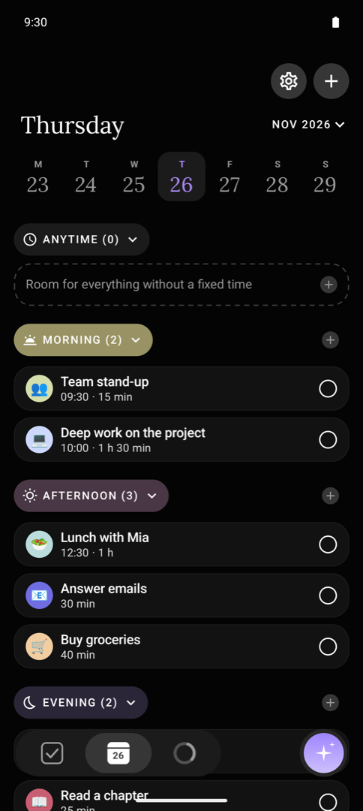
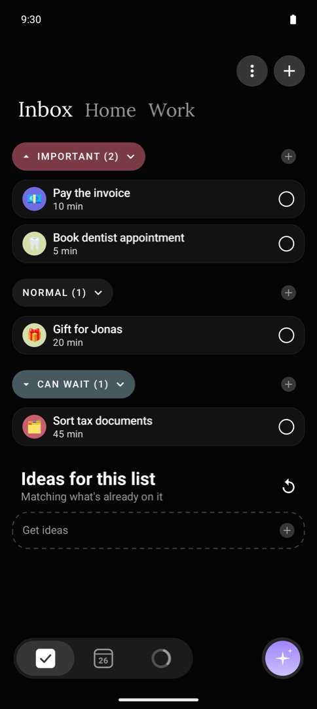
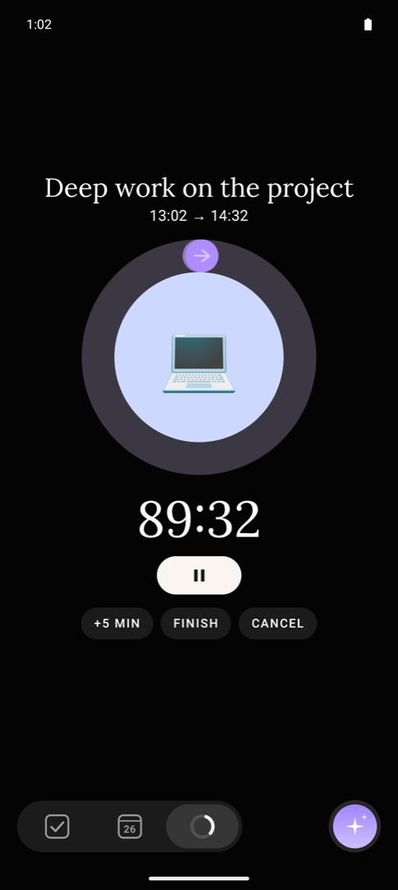
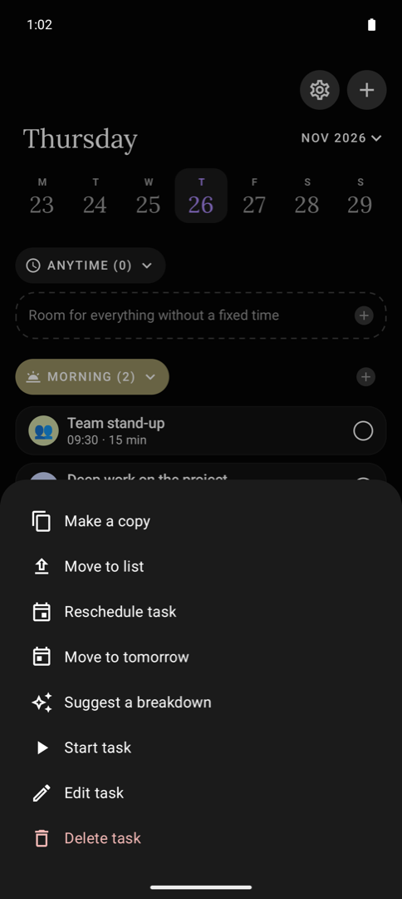
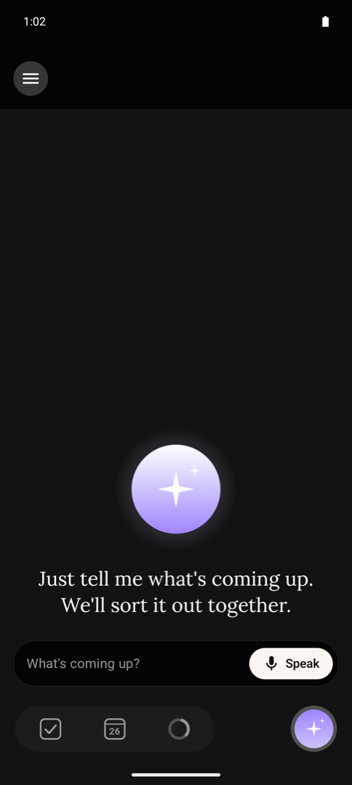

# Tagwerk (prototype)

A free day planner for Android. No account, no ads, no tracking. The AI features use your own Claude API key and talk directly from your device to Anthropic.

<p align="center">
  
  
  
  
  
</p>

## Download

Grab the latest APK from the [Releases page](https://github.com/seba-do/tagwerk/releases/latest) and install it on a device running Android 9 or newer. You may need to allow installs from unknown sources.

## Features

- **Plan:** week strip, sections of the day, a fixed time or a rough time of day; long-press a card to drag it into any section, including empty ones, or onto "Done", with the list scrolling along; tapping opens a menu to copy, move, reschedule, break down, start, edit and delete; pull down to reload calendar events
- **Calendar:** events from the device's calendars appear in the plan, read-only and toggleable per calendar; they are not stored and never sent to the AI
- **Lists:** multiple lists, grouped by priority, task size or Eisenhower, sorted manually, alphabetically or by duration, with done items and suggestions hideable; dragging into a group takes over its priority or Eisenhower quadrant; tapping opens the menu, for example to schedule an item
- **Focus:** timer based on timestamps, pause, `+5`, a timer per step, quick start without a task, an alarm at the end and at every step change, even with the app closed and after a reboot
- **Reminders:** tasks with a fixed time notify 10 minutes before and at the start, even with the app closed and after a reboot; from the notification you can open them, start them as a focus session or check them off; both reminders can be switched off in the settings
- **Widgets:** two home screen widgets, small and wide, showing today's next task or the running timer with a ring, countdown and the buttons +5, Pause and Done; the wide one lets you check off steps
- **Assistant:** chat with suggestions you confirm first, plus voice input through the system
- **Form:** quick add with chips, the full form with date, duration and notes behind the three dots; emoji and free color for tasks and steps
- **Steps:** the emoji follows the title live, reorder with a handle, a timer per step with 10 minutes as the default; their sum becomes the duration
- **Repeats:** daily, weekdays, weekends, weekly, every two weeks, monthly, yearly or a custom rhythm, optionally with an end date; edit and delete either one occurrence, this and following, or all
- **Break down and ideas:** AI suggestions for steps and list items
- **Motion:** fireworks, custom sounds and haptics when checking off, a focus ring you can turn, swipe between days and weeks, long-press to move cards, swipe left in lists to delete with undo; can be switched off in the settings, and fireworks are skipped when animations are disabled system-wide
- **Settings:** API key encrypted in the Android Keystore, model choice, key test

The app is available in English and German and follows the device language.

## Translations

All texts live in [`i18n/strings.txt`](i18n/strings.txt), one line per string with English and German side by side. After editing it, regenerate the Android resources:

```bash
python3 i18n/gen.py
```

## Build and test

```bash
./gradlew testDebugUnitTest assembleDebug
```

Install on one specific device only, because `installDebug` targets every connected device:

```bash
adb -s emulator-5554 install -r app/build/outputs/apk/debug/app-debug.apk
```

## Not included yet

Countdown in the notification, a dedicated Google or iCloud sign-in (the calendar comes through Android), sync and backup. Chats are not stored. Storage is a JSON file for this prototype, and the app icon is a placeholder.

## Scope and attribution

The interface is deliberately modeled closely on Tiimo: layout, sizes and colors were measured from screenshots and rebuilt. The design should become more independent before any wider release.

No files were copied: code, texts, sounds and graphics are original, and the mascot and Tiimo's typeface Recoleta are not included. Headings use Lora under the SIL Open Font License (`app/src/main/assets/licenses/Lora-OFL.txt`). The dark color scheme is measured, the light one is derived independently. The name is a working title and has not been checked for trademarks.

## License

Tagwerk is free software under the [GNU General Public License v3.0](LICENSE). The bundled Lora font is licensed separately under the SIL Open Font License 1.1.
